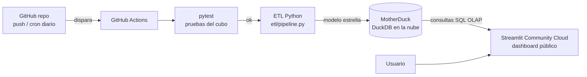
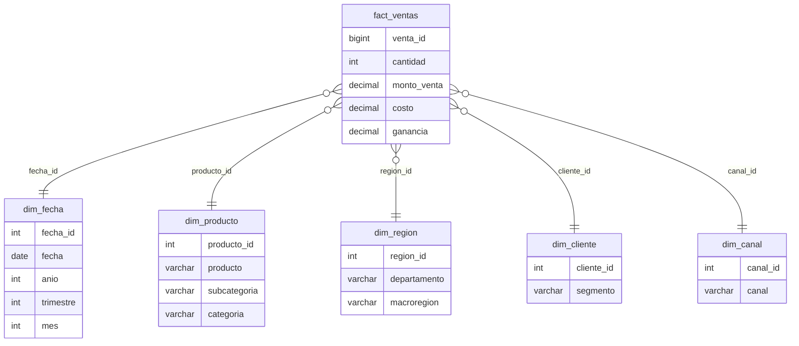

# 🧊 Cubo OLAP de Ventas Retail con DuckDB + MotherDuck + Streamlit

Solución de **procesamiento analítico en línea (OLAP)** construida sin AWS:

- **DuckDB / MotherDuck** como motor OLAP columnar (MotherDuck = DuckDB en la nube, plan gratuito).
- **Modelo estrella** (1 tabla de hechos + 5 dimensiones) con ~68 000 ventas de una cadena retail peruana (2023–2026).
- **GitHub Actions** automatiza las pruebas y la carga diaria de datos a MotherDuck.
- **Streamlit Community Cloud** publica el dashboard interactivo en una URL pública.

> 🔗 **Demo:** `https://<tu-app>.streamlit.app` · 📝 **Artículo:** `<enlace a Medium/Dev.to>` · 🎥 **Video:** `<enlace>`

---

## Arquitectura



## Modelo estrella



| Jerarquía | Niveles |
|---|---|
| Tiempo | Año → Semestre → Trimestre → Mes → Día |
| Producto | Categoría → Subcategoría → Producto |
| Geografía | Macroregión → Departamento |

## Operaciones OLAP en el dashboard

| Operación | Dónde |
|---|---|
| **Roll-up / Drill-down** | Pestaña *tiempo* (Año ↔ Trimestre ↔ Mes ↔ Día) y pestaña *producto* (Categoría ↔ Subcategoría ↔ Producto) |
| **Slice** | Pestaña *Slice*: fija una dimensión en un valor |
| **Dice** | Barra lateral: filtros combinados en varias dimensiones |
| **Pivot** | Pestaña *Pivot*: filas × columnas configurables, con botón para rotar |
| **ROLLUP / CUBE** | Pestaña *ROLLUP / CUBE*: subtotales nativos de SQL |

Más ejemplos en [sql/consultas_olap.sql](sql/consultas_olap.sql) (GROUPING SETS, funciones de ventana, crecimiento interanual…).

## Estructura

```
├── etl/
│   ├── db.py              # conexión: MotherDuck (con token) o DuckDB local
│   ├── generar_datos.py   # datos sintéticos de ventas (estacionalidad peruana)
│   └── pipeline.py        # ETL: crea el esquema y carga el modelo estrella
├── sql/
│   ├── schema.sql         # DDL del modelo estrella + vista v_ventas
│   └── consultas_olap.sql # consultas OLAP de ejemplo
├── tests/test_olap.py     # pruebas (integridad, ROLLUP, CUBE, histórico estable)
├── streamlit_app.py       # dashboard
└── .github/workflows/etl.yml  # automatización CI/CD
```

## Ejecutar en local

```bash
python -m venv .venv
.venv\Scripts\activate          # Windows  (Linux/Mac: source .venv/bin/activate)
pip install -r requirements-dev.txt

python -m etl.pipeline --local  # crea data/olap_ventas.duckdb
pytest                          # 8 pruebas
streamlit run streamlit_app.py  # http://localhost:8501
```

## Despliegue en la nube (paso a paso)

1. **MotherDuck:** crea una cuenta gratis en [motherduck.com](https://motherduck.com) → *Settings → Access Tokens* → crea un token.
2. **GitHub:** sube este repositorio como **público** → *Settings → Secrets and variables → Actions* → nuevo secreto `MOTHERDUCK_TOKEN`.
3. **Primera carga:** pestaña *Actions* → *ETL OLAP* → **Run workflow**. Al terminar, la base `olap_ventas` aparece en MotherDuck.
4. **Streamlit Cloud:** en [share.streamlit.io](https://share.streamlit.io) → *Create app* → elige el repo, rama `main`, archivo `streamlit_app.py` → *Advanced settings → Secrets*:
   ```toml
   MOTHERDUCK_TOKEN = "tu_token"
   ```
5. Listo: cada `push` ejecuta las pruebas y recarga los datos; Streamlit redespliega solo. Además, el *cron* carga las ventas del día anterior todos los días a las 06:00 (hora de Perú).

> Sin token, la app funciona igual con una base DuckDB local que se genera al iniciar.

## Tecnologías

DuckDB 1.3 · MotherDuck · Python 3.12 · pandas · Streamlit · Plotly · pytest · GitHub Actions
